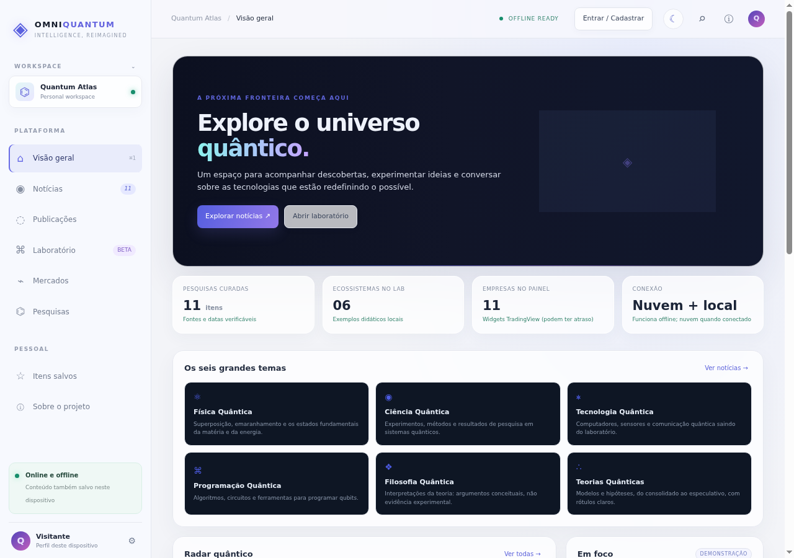
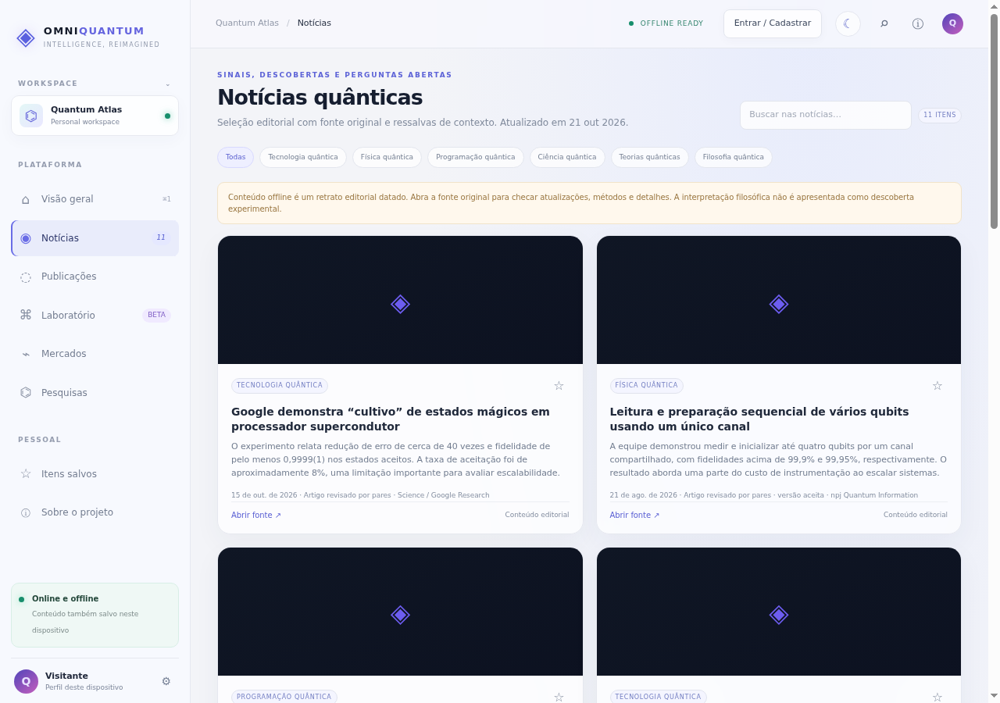
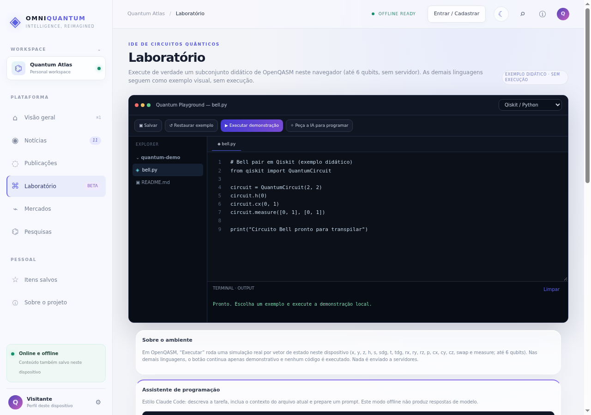
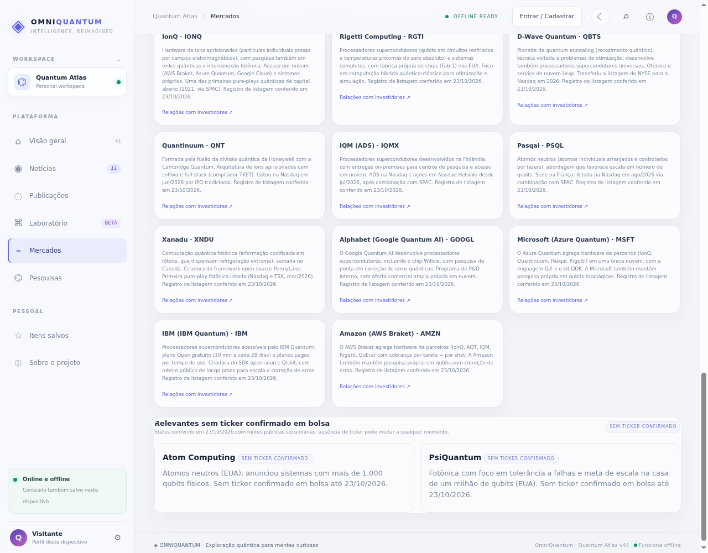
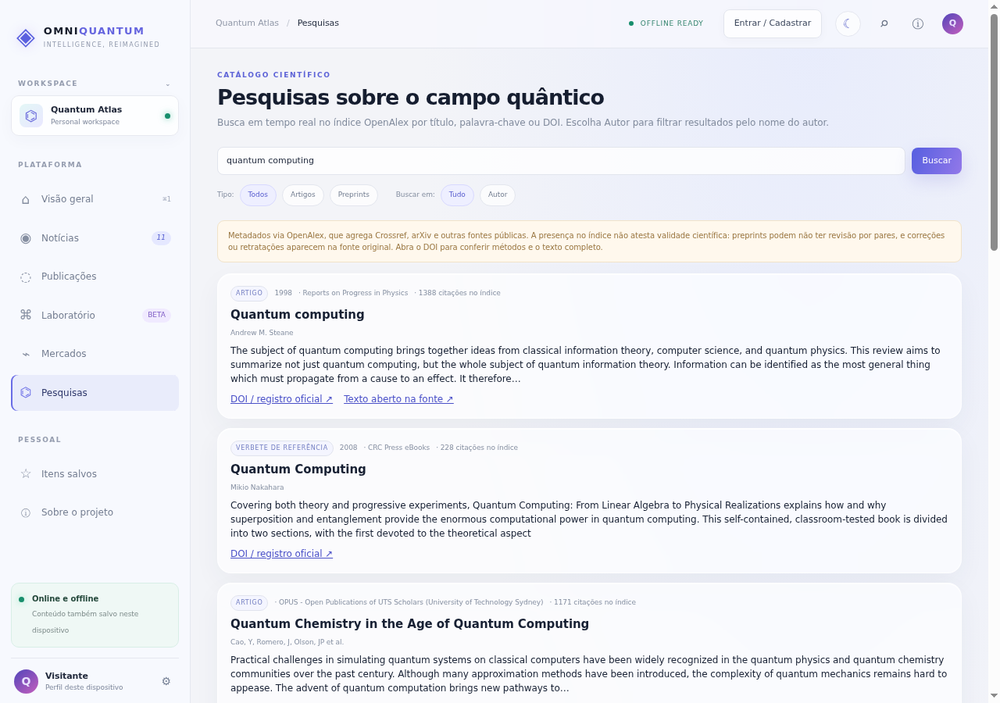
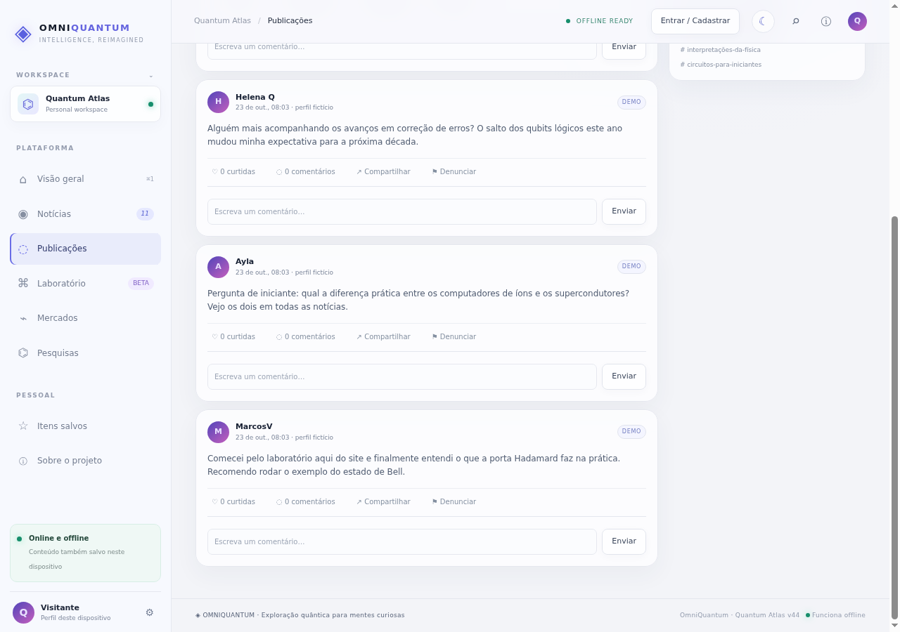
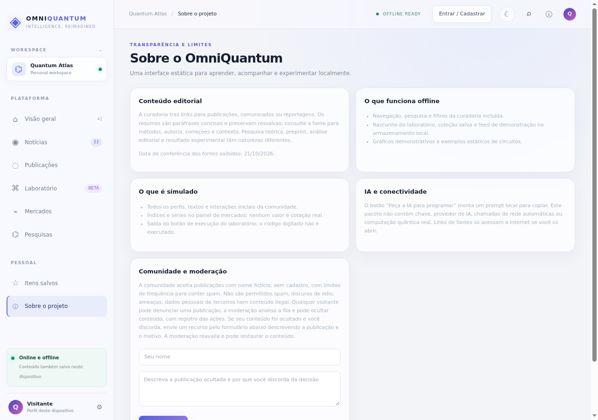

# OmniQuantum

**Explore o universo quântico.** Notícias de ciência, laboratório de circuitos quânticos, comunidade e painel de mercados do setor — em uma plataforma que roda inteira no navegador.

## O que é

A OmniQuantum é uma plataforma sobre o universo da física quântica. A ideia é reunir em um só lugar o que hoje está espalhado por periódicos, laboratórios, blogs e painéis financeiros: notícias com fonte original, um laboratório didático de circuitos, catálogo de pesquisas, comunidade aberta e um panorama das empresas do setor.

Tudo roda no navegador, como aplicativo instalável (PWA) com funcionamento offline. A conta é opcional: dá para explorar quase tudo como visitante.

## Tour pela plataforma

### Visão geral

A porta de entrada: os seis grandes temas da plataforma (física, ciência, tecnologia, programação, filosofia e teorias quânticas), radar de novidades e indicadores do que existe dentro do app. O mesmo conteúdo fica disponível offline depois da primeira visita.

### Notícias quânticas

Curadoria de notícias do campo quântico com link direto para a fonte original de cada item, data declarada e ressalvas de contexto. O aviso de "retrato editorial datado" fica visível quando o conteúdo vem do cache offline — a plataforma prefere mostrar a data do que fingir atualidade.

### Laboratório

Um ambiente de experimentação com editor de código. Em OpenQASM, o botão "Executar" roda uma simulação real por vetor de estado, no próprio dispositivo, com até 6 qubits e sem servidor. Nas demais linguagens, os exemplos são visuais e o rótulo "exemplo didático, sem execução" deixa isso explícito. O assistente de programação apenas monta um prompt local para você levar à ferramenta de IA da sua preferência — nenhum código é enviado a terceiros.

### Mercados

Painel do ecossistema comercial: 11 empresas listadas em bolsa, organizadas em pure-plays estabelecidas, novas pure-plays de 2026 (Quantinuum, IQM, Pasqal, Xanadu) e big techs com programas quânticos (Alphabet, Microsoft, IBM, Amazon), cada uma com perfil explicativo sobre sua arquitetura e atuação. Uma seção separada cobre empresas relevantes sem ticker confirmado, com aviso de que o status pode mudar. Os gráficos são widgets oficiais TradingView com dados em atraso — e o app diz isso na tela. Nada ali é recomendação de investimento.

### Pesquisas

Busca em tempo real no índice OpenAlex (que agrega Crossref, arXiv e outras fontes públicas) por título, palavra-chave, DOI ou autor. Preprints e retratações aparecem com selos próprios, porque presença no índice não atesta validade científica.

### Comunidade

Espaço aberto de conversas: publicar não exige cadastro — um nome fictício por publicação é gerado para quem prefere. A captura acima mostra apenas conteúdo de demonstração, rotulado como DEMO com perfis fictícios. Há moderação com fila de análise, registro de ações, botão de denúncia em cada publicação e formulário de contestação para quem discordar de uma decisão.

### Transparência

A página "Sobre" declara os limites do produto: o que funciona offline, o que é simulado, o que é demonstração, como a IA é (não) usada e como a moderação opera. É o contrato honesto da plataforma com quem visita.

## O que já funciona

- Aplicativo web instalável (PWA) com cache versionado e modo offline.
- Conta por e-mail/senha ou Google, com perfil e nome de exibição editável — opcional para leitura.
- Notícias com acúmulo persistente de histórico e mescla diária com fontes RSS.
- Simulador de circuitos OpenQASM 100% local (até 6 qubits).
- Catálogo de pesquisas via OpenAlex com selos de preprint e retratação.
- Comunidade com anti-spam, denúncia, moderação com auditoria e contestação.
- Painel de mercados com 11 empresas listadas e perfis explicativos conferidos em fontes públicas.
- Temas claro e escuro, com contraste medido (WCAG) e layout verificado em telas de 360 px em diante.

## Em desenvolvimento

- Artes visuais próprias para o hero e para os cards (a primeira — um buraco negro com disco de acreção desenhado em SVG pelo time do projeto — está em revisão; os fundos atuais são provisórios).
- Imagens contextuais para notícias e empresas.
- Edição e exclusão dos próprios comentários na comunidade (publicações já podem ser editadas e excluídas pelo autor).
- Melhorias contínuas de conteúdo editorial e de acessibilidade.

## Limites declarados

- Cotações e gráficos de mercado chegam com atraso indicado pelo próprio provedor; nada no painel é recomendação de investimento.
- Perfis, publicações e interações marcadas como DEMO são demonstração, não usuários reais.
- O laboratório executa apenas o subconjunto didático de OpenQASM; outros exemplos não rodam código.
- O acesso gratuito a computadores quânticos reais citado no app (IBM Quantum, AWS Braket, Azure Quantum, D-Wave Leap) segue os limites e custos publicados por cada provedor.

## Código e privacidade

O código-fonte é privado e este repositório é a vitrine pública do projeto — sem downloads por enquanto. As capturas acima mostram o produto real em uso por visitante, sem dados de conta.

## Acesse

**[omniquantum.vercel.app](https://omniquantum.vercel.app)** — gratuito, sem instalação, funciona no celular e no computador.
