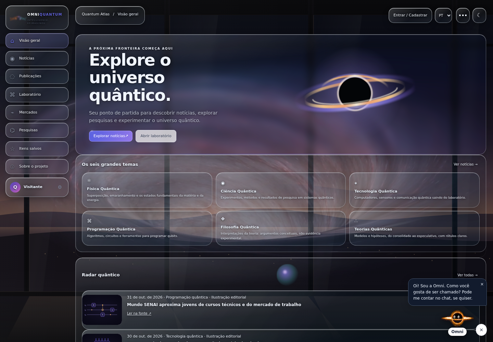
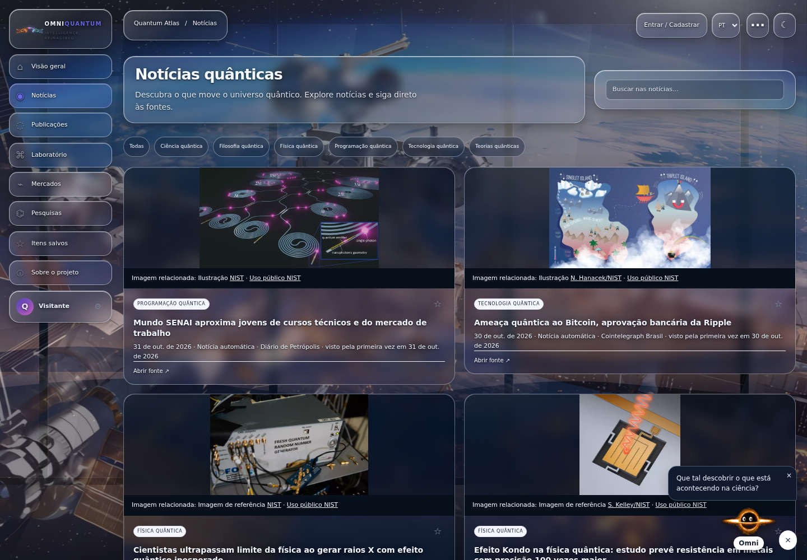
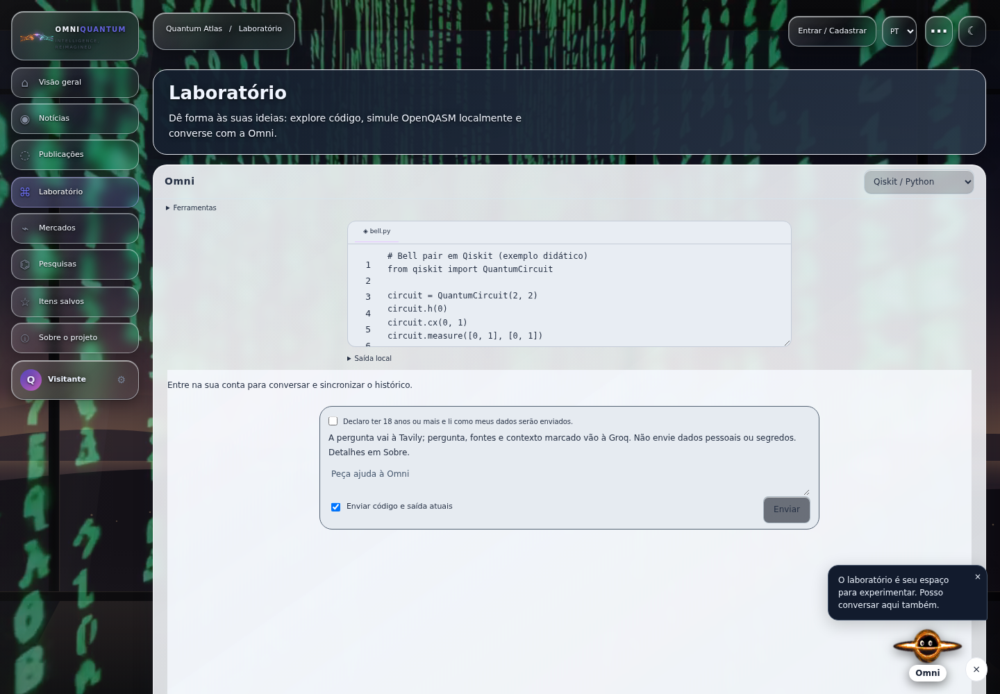
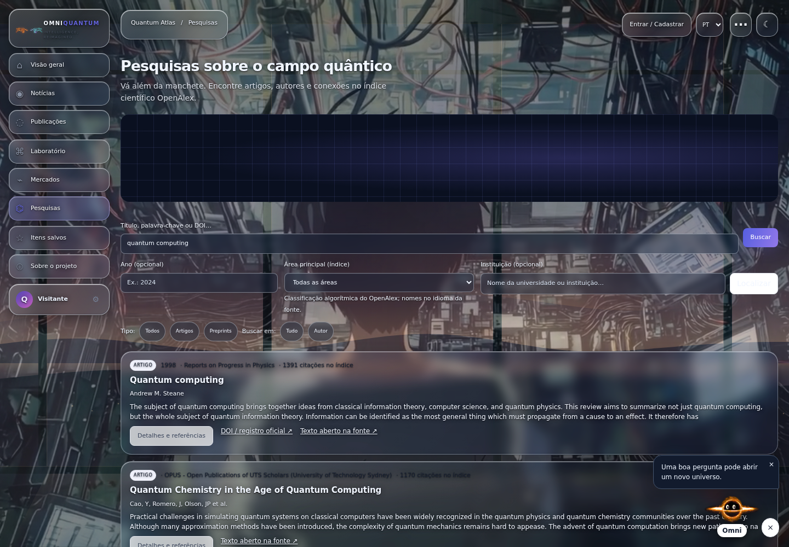
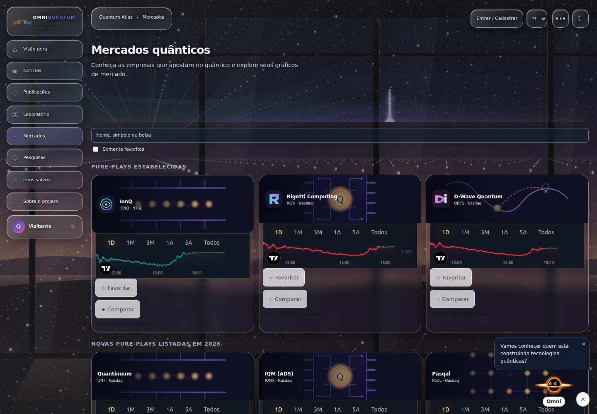
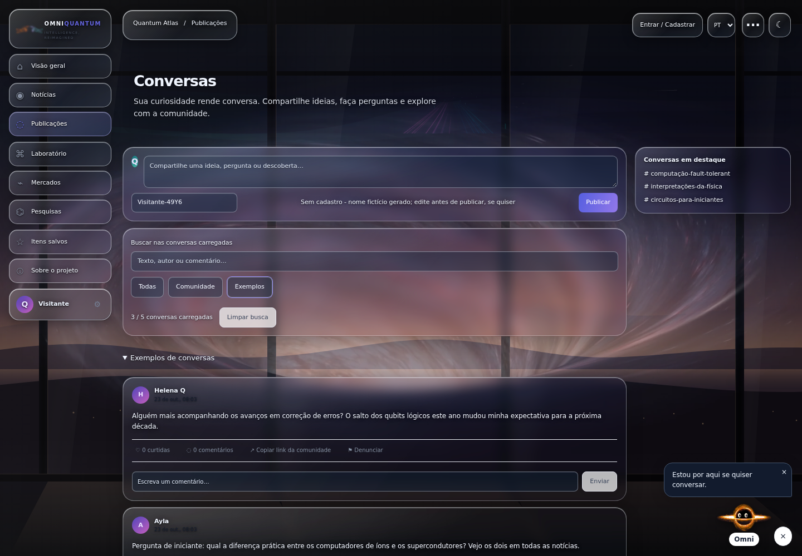
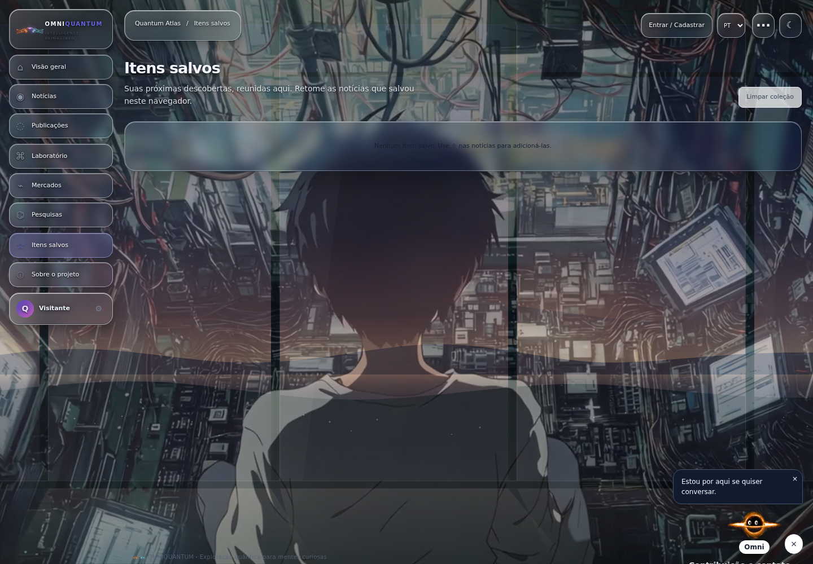

# OmniQuantum

## O universo quântico não precisa ficar distante.

Ciência, código e curiosidade em uma só experiência. Explore notícias, investigue pesquisas, experimente circuitos e conheça as empresas que estão construindo o setor.

[Acessar a OmniQuantum](https://omniquantum.vercel.app/) · [Apresentação anterior e capturas históricas](docs/historico/apresentacao-anterior/README.md)

> Beta em evolução. Capturas reais da interface em 31/10/2026. As limitações de simulação, IA, dados e conectividade estão descritas abaixo.

## Uma nova experiência para explorar o universo quântico

A OmniQuantum reúne notícias, pesquisas, programação, comunidade e empresas do setor em uma experiência visual feita para despertar curiosidade e levar você às fontes. Do primeiro contato com um qubit ao estudo de circuitos, o ponto de partida está aqui.

- Uma interface com fundos imersivos, camadas de vidro, animações e navegação adaptada ao celular e ao computador.
- Português, inglês e espanhol na interface. A disponibilidade de tradução varia conforme o conteúdo e a fonte.
- Oito áreas conectadas: visão geral, notícias, publicações, laboratório, mercados, pesquisas, itens salvos e sobre o projeto.

## Notícias: descubra, filtre, confira

Acompanhe temas do universo quântico sem perder o caminho até a publicação original.

- Curadoria editorial e coleta periódica de notícias de fontes públicas, com busca e filtros por tema.
- Cartões com imagens automáticas, indicação de imagem relacionada ou ilustração editorial e crédito quando disponível.
- Títulos em múltiplos idiomas, favoritos e acesso à fonte. A imagem da notícia também abre a publicação de origem.
- Uma notícia no índice não é um atestado científico. Consulte a fonte, os métodos e as ressalvas do trabalho.

## Quantum Lab: ideias ganham forma

Um espaço para explorar código, experimentar circuitos didáticos e pedir ajuda à Omni, sem confundir simulação com hardware quântico.

- Editor com exemplos de Qiskit, PennyLane, OpenQASM 3, Q# / QDK, Cirq e CUDA-Q.
- Execução local de um subconjunto didático de OpenQASM, por vetor de estado, com até 6 qubits.
- Ferramentas do laboratório para exemplos, simulações, projetos e compartilhamento.
- Assistente Omni com pesquisa web após envio explícito, entrada na conta e declaração de idade de 18 anos ou mais.
- O código e a saída atuais só acompanham a pergunta quando essa opção está marcada. A IA não executa o código nem altera o editor sozinha.
- Histórico privado associado à conta, com exclusão de registros e da conta. Não confunda esse histórico com a conversa temporária do mascote.

## Omni: companhia durante a exploração

O mascote Omni acompanha a navegação e oferece um ponto de conversa leve dentro da experiência.

- A conversa do mascote é temporária: pode ser reiniciada ao navegar ou recarregar a página.
- Esse comportamento é separado do histórico da assistente no laboratório. Não há promessa de memória permanente do mascote.

## Pesquisas: vá além da manchete

Explore metadados de trabalhos científicos via OpenAlex e abra os links de origem para continuar a investigação.

- Busca de trabalhos e filtros para explorar o campo quântico.
- Links para DOI e páginas de origem, conforme disponíveis nos registros.
- Preprints, artigos e outros registros têm níveis diferentes de revisão. Presença no catálogo não comprova validade científica nem garante texto completo.

## Mercados: conheça quem constrói o setor

Descubra empresas relacionadas à tecnologia quântica e explore gráficos de mercado fornecidos pelo widget oficial TradingView.

- Catálogo de empresas com descrições, busca, favoritos e comparação.
- Gráficos reais do provedor, com períodos selecionáveis e identificação do símbolo e da bolsa.
- Os dados podem ter atraso e dependem de conexão, bolsa e provedor. O painel não é recomendação de investimento.

## Conversas: curiosidade vira comunidade

Compartilhe perguntas, ideias e descobertas em uma comunidade em fase beta.

- Publicações, comentários e curtidas, com identificação de visitante e busca nas conversas carregadas.
- Conteúdo da comunidade separado de exemplos de conversas fictícias.
- Denúncia e recurso aparecem na interface, mas os fluxos de moderação ainda não foram comprovados de ponta a ponta em produção. Não há prazo ou resultado garantido.

## Sua coleção, do seu jeito

Guarde referências para retomar depois e reúna suas descobertas em itens salvos.

- Favoritos e coleção local para organizar o que chamou sua atenção.
- Parte da navegação, da curadoria incluída, dos exemplos e dos rascunhos funciona com dados locais.
- Notícias carregadas da rede, pesquisas externas, conta, IA, comunidade e gráficos precisam de conectividade para suas funções online. O aplicativo não funciona integralmente offline.

## O salto em relação à apresentação anterior

A nova apresentação acompanha uma plataforma que deixou de ser descrita apenas como uma experiência local com exemplos estáticos.

- Antes: apresentação centrada no aplicativo local. Agora: conta e serviços online convivem com recursos locais.
- Antes: destaque em circuitos demonstrativos e prompts. Agora: editor em várias linguagens, execução didática de OpenQASM e assistente de laboratório com pesquisa web.
- Agora: notícias com imagens automáticas e acesso direto às fontes, pesquisa OpenAlex, gráficos TradingView e nova navegação visual.
- A apresentação anterior continuará acessível em uma seção histórica visível deste repositório, com suas capturas originais. Ela documenta uma etapa anterior, não o estado atual.

## Transparência faz parte do projeto

A ambição é abrir caminhos para aprender e explorar, não anunciar resultados que ainda não existem.

- Não executa em uma QPU nem demonstra vantagem quântica. A simulação local tem limites didáticos.
- As outras linguagens do editor são exemplos visuais, sem execução de Python, Q#, Cirq ou CUDA-Q no aplicativo.
- Respostas de IA não são validadas automaticamente como verdade científica. Confira fontes, versões, cálculos e resultados.
- No laboratório, Tavily recebe a pergunta de pesquisa; Groq recebe pergunta, fontes e contexto marcado. Não envie dados pessoais, segredos ou código privado.
- O beta é gratuito, mas há limites globais e limites dos provedores. Ausência de teto diário por conta não significa uso ilimitado.
- Exemplos de conversas são fictícios. Imagens editoriais não devem ser confundidas com registros do experimento ou da notícia.
- Código privado, credenciais e dados pessoais não fazem parte desta vitrine pública.

## O que vem depois

A plataforma segue como beta em evolução. Melhorias experimentais não são apresentadas como funções já disponíveis.

- As capturas desta apresentação mostram a versão acessível em 31 de outubro de 2026.
- Novos recursos só serão anunciados como disponíveis depois de publicados e conferidos.
- Explore o aplicativo, abra as fontes e acompanhe os próximos passos neste repositório.

---

**OmniQuantum · Explore. Questione. Experimente. Confira as fontes.**
